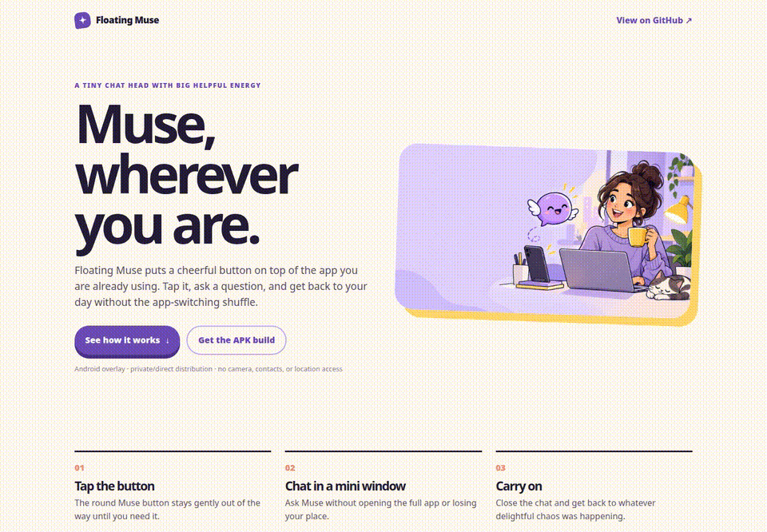
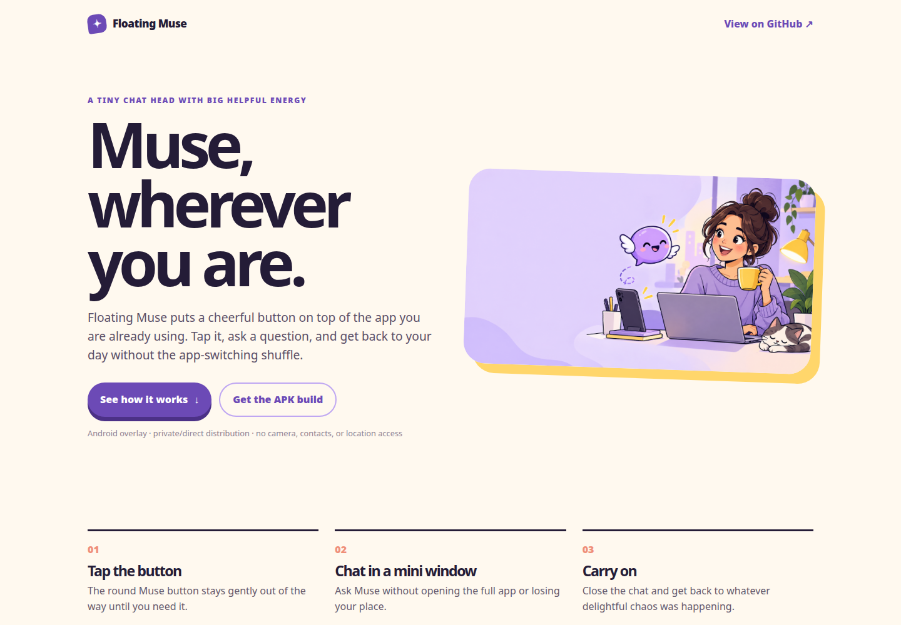
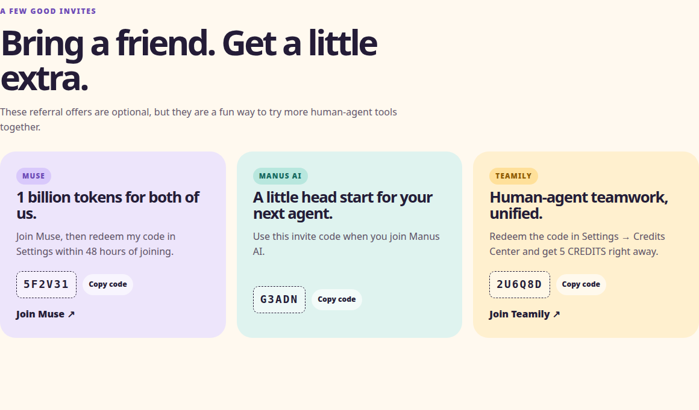
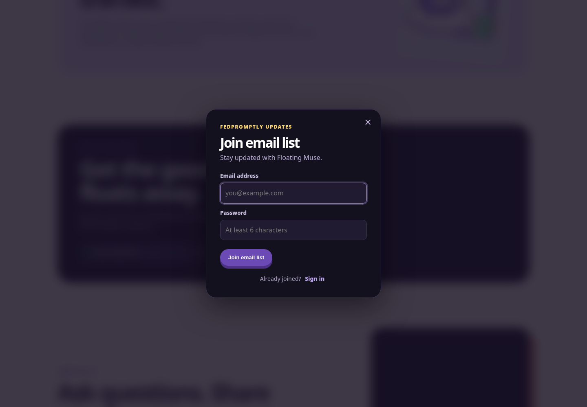

# Floating Muse

A small Android chat-head overlay that keeps Muse one tap away, plus a static landing page for sharing the project and its community links.

> **Status:** The static site runs locally and is ready for GitHub Pages or Cloudflare Pages. The Android app is source-only in this repository; no APK or live public demo is committed yet.

## Why this exists

Switching away from the app you are currently using just to ask one quick question is friction. It breaks focus, adds taps, and makes a small task feel like a context switch.

Floating Muse is designed for that narrow moment: a draggable round button sits above the current app, and tapping it opens a compact WebView chat window. The Android helper is intentionally small and asks only for the permissions it needs to display the overlay, keep its foreground service alive, use the network, restore after boot, and show its notification.

This repository also contains the public-facing site in [`site/`](site/). It explains the idea, shows the referral promotions, embeds the Discord community, provides the email-list modal, and links to the supplied Patreon flow.

## See it work

The fastest working demo is the static site. It is real HTML, CSS, and JavaScript from this repository—not a mockup.

```bash
python3 -m http.server 8000 --directory site
```

Then open <http://127.0.0.1:8000/>. The page includes the working navigation, referral-code copy buttons, email-list modal, responsive layout, favicon, and external Discord/Patreon links.

### Demo walkthrough



The GIF was captured from the local site while moving through its actual hero, referral, Discord, email-list, and call-to-action sections.

### Real screenshots








The Discord iframe is part of the live page, but its contents depend on Discord's external widget response and may appear blank in offline or headless captures.

## Quick start

### Preview the website

```bash
# install: no package install is required
python3 -m http.server 8000 --directory site

# open in a browser
# http://127.0.0.1:8000/
```

### Build the Android app

The Android entry point is [`SettingsActivity.kt`](app/src/main/java/com/fedos/floatingmuse/SettingsActivity.kt). The app module is configured for application ID `com.fedos.floatingmuse`, `minSdk 26`, `targetSdk 35`, and Java/Kotlin 17.

This checkout does **not** include a Gradle wrapper or a prebuilt APK. With Android Studio or a machine that has Gradle, JDK 17, and the Android SDK installed:

```bash
gradle :app:assembleDebug
```

The debug APK should be produced at:

```text
app/build/outputs/apk/debug/app-debug.apk
```

Before building for real use, replace the placeholder chat URL in [`app/src/main/res/values/strings.xml`](app/src/main/res/values/strings.xml) if the correct Muse chat endpoint is different from the current value.

### Test / verify

There is no automated test suite in this repository yet. The available lightweight checks are:

```bash
# Validate the site JavaScript syntax
node --check site/email-list.js
node --check site/promo-codes.js

# Serve the site and verify it loads in a browser
python3 -m http.server 8000 --directory site
```

The GitHub Actions Android workflow builds the debug APK on pushes to `main` and manual workflow runs. It uploads the APK as the `floating-muse-debug-apk` artifact.

## What the Android app does

1. `SettingsActivity` opens the overlay-permission screen, requests notifications on Android 13+, and starts the foreground service.
2. `FloatingButtonService` creates a `TYPE_APPLICATION_OVERLAY` button, lets the user drag it, and opens `MiniChatActivity` on tap.
3. `MiniChatActivity` hosts `ChatWebView`, which loads the configured Muse URL.
4. `BootReceiver` attempts to restore the foreground service after boot when overlay permission is already granted.

Required Android permissions are declared in [`AndroidManifest.xml`](app/src/main/AndroidManifest.xml): overlay, internet, foreground service, the Android 14+ special-use foreground-service permission, boot completed, and notifications. The app does not request camera, contacts, location, or storage access.

The overlay is constrained by Android. It cannot cover the status bar, navigation bar, lock screen, or permission dialogs. Android 14 and newer also enforce foreground-service rules more strictly.

## Project map

```text
FloatingMuse/
├── app/                         # Android application source
│   └── src/main/
│       ├── AndroidManifest.xml
│       ├── java/com/fedos/floatingmuse/
│       └── res/
├── site/                        # Static landing page and browser scripts
│   ├── index.html
│   ├── styles.css
│   ├── email-list.js
│   ├── promo-codes.js
│   └── assets/
│       └── demo/                # Real local-site screenshots and GIF
├── .github/workflows/
│   ├── build-apk.yml            # Debug APK artifact workflow
│   └── deploy-site.yml          # GitHub Pages workflow
└── wrangler.toml                # Cloudflare Pages output configuration
```

## Deployment

### GitHub Pages

The workflow at [`.github/workflows/deploy-site.yml`](.github/workflows/deploy-site.yml) publishes the `site/` directory with GitHub Pages when `main` changes. In the repository settings, set **Pages → Source** to **GitHub Actions**.

This repository does not contain a confirmed public GitHub URL or a deployed Pages URL, so no live-demo badge is claimed here.

### Cloudflare Pages

The root [`wrangler.toml`](wrangler.toml) points Cloudflare Pages at `./site`:

```bash
npx wrangler login
npx wrangler pages project create floating-muse-site
npx wrangler pages deploy site --project-name floating-muse-site
```

Alternatively, connect the repository through Cloudflare Pages' Git integration and use `site` as the output directory. Use one deployment path for a given custom domain rather than publishing the same domain through both GitHub Pages and Cloudflare Pages workflows.

### Before publishing

The static page still contains placeholder `https://github.com/` links for the repository and APK CTA because this checkout does not identify the real repository URL. Replace those links in [`site/index.html`](site/index.html) before publishing. Also confirm the Supabase redirect URLs for the final GitHub Pages or Cloudflare Pages domain.

## Contributing

Small improvements are easiest to review when they stay focused: update the static site under `site/`, Android behavior under `app/`, and the relevant workflow or deployment file when build behavior changes. Please include a reproducible local command in the pull request description.

## License

No license file is present in this repository, so the project currently has no declared open-source license.
